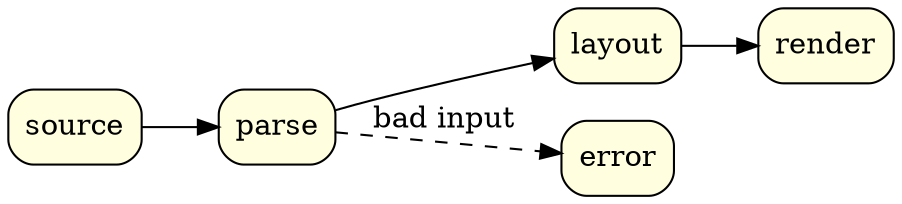

I had fun adding `pikchr` and `gnuplot` rendering to this blog, based on my VS Code
preview extensions for them, so I kept going with other text-to-diagram tools I know and
love (or at least respect). It now also renders `graphviz`, `smiles`, `smarts`, `spice`
and `onnx`. I'll probably keep going with this, or turn it into tools I need or find
useful, as I did with [Pikchard](/posts/introducing-pikchard/).

Every fence becomes inline SVG when the site is built, using the same renderers as my VS
Code preview extensions:
[Pikchr](https://github.com/Reonarudo/pikchr-markdown-preview),
[Gnuplot](https://github.com/Reonarudo/gnuplot-markdown-preview),
[Graphviz](https://github.com/Reonarudo/graphviz-markdown-preview),
[SMILES](https://github.com/Reonarudo/smiles-markdown-preview),
[SPICE](https://github.com/Reonarudo/spice-markdown-preview) and
[ONNX](https://github.com/Reonarudo/onnx-markdown-preview). Visitors get finished
pictures: no JavaScript and no wasm.

This page has one fence of each kind. It also checks every build: if any of these
stops rendering, the site doesn't deploy.

## Graphviz

A `graphviz` fence holds a DOT graph:

````markdown

````

```graphviz {alt="A four-stage pipeline from source to render, with parse branching to error"}
digraph {
  rankdir=LR
  node [shape=box style="rounded,filled" fillcolor=lightyellow]
  source -> parse -> layout -> render
  parse -> error [label="bad input" style=dashed]
}
```

Node shapes and edge labels make DOT a natural fit for state machines. This one accepts
signed decimal numbers; the double circles are its accepting states. `caption` adds a
figure caption, and the `layout` graph attribute picks one of the other Graphviz
engines (`neato`, `circo`, …) when `dot` isn't the right one:

```graphviz {alt="A state machine accepting signed decimal numbers: an optional sign, digits, then optionally a dot and more digits" caption="A state machine for signed decimal numbers."}
digraph {
  rankdir=LR
  node [shape=circle style=filled fillcolor=lightblue fontname=Helvetica]
  edge [fontname=Helvetica fontsize=11]
  start [shape=point width=0.12]
  int [shape=doublecircle]
  frac [shape=doublecircle]
  start -> s0
  s0 -> sign [label="+ -"]
  s0 -> int [label="0-9"]
  sign -> int [label="0-9"]
  int -> int [label="0-9"]
  int -> dot [label="."]
  dot -> frac [label="0-9"]
  frac -> frac [label="0-9"]
}
```

## SMILES

A `smiles` fence holds one molecule per line. Anything after the first space is a label:

````markdown
```smiles
CC(=O)Oc1ccccc1C(=O)O aspirin
```
````

```smiles {alt="The structure of aspirin"}
CC(=O)Oc1ccccc1C(=O)O aspirin
```

Several lines are drawn side by side, in a single row:

```smiles {alt="Ethanol, benzene and caffeine" caption="Ethanol, benzene and caffeine."}
CCO ethanol
c1ccccc1 benzene
Cn1cnc2c1c(=O)n(C)c(=O)n2C caffeine
```

SMILES has no notation for a polymer chain, so PubChem records polymers as the monomers
they're made from, written as one mixture with `.` between the parts. Nafion, a
perfluorinated sulfonic acid membrane, is tetrafluoroethylene plus a sulfonic acid vinyl
ether ([CID 61889](https://pubchem.ncbi.nlm.nih.gov/compound/61889)):

```smiles {alt="Nafion's monomers: a perfluorinated sulfonic acid vinyl ether and tetrafluoroethylene" caption="Nafion, as PubChem records its monomers. The ? marks a stereocentre the record leaves unspecified."}
C(=C(F)F)(OC(C(C(F)(F)F)(OC(C(F)(F)S(=O)(=O)O)(F)F)F)(F)F)F.C(=C(F)F)(F)F Nafion
```

Surlyn, an ethylene–methacrylic acid ionomer, is shown as its sodium salt
([CID 23688925](https://pubchem.ncbi.nlm.nih.gov/compound/23688925)):

```smiles {alt="Surlyn's monomers: sodium methacrylate and ethylene" caption="Surlyn (sodium), as PubChem records its monomers."}
CC(=C)C(=O)[O-].C=C.[Na+] Surlyn
```

## SMARTS

A `smarts` fence takes the same layout, but each line is a substructure pattern instead
of a molecule:

```smarts {alt="Three SMARTS patterns" caption="A carboxylic acid, a primary amine, and a six-membered carbon ring with any bonds."}
[CX3](=O)[OX2H1] carboxylic acid
[NX3;H2][CX4] primary amine
[#6]1~[#6]~[#6]~[#6]~[#6]~[#6]~1 any C6 ring
```

## SPICE

A `spice` fence holds a netlist, and the schematic is drawn from it. Netlists are read
as ngspice unless the fence names a `dialect`. Included files resolve relative to the
post, so this buck converter takes its switch and diode models from a file next to this
page:

````markdown
```spice
* 12 V to 5 V buck converter, 100 kHz
.include models/buck.lib
VIN in 0 DC 12
VG gate 0 PULSE(12 0 0 10n 10n 4.2u 10u)
M1 sw gate in in PSW
D1 0 sw DSCH
L1 sw out 22u
C1 out 0 47u
RL out 0 5
.tran 0.1u 2m
```
````

```spice {alt="A buck converter: a PMOS switch from 12 V, a freewheeling diode, and an LC filter feeding a 5 ohm load" caption="A 12 V to 5 V buck converter, switched at 100 kHz."}
* 12 V to 5 V buck converter, 100 kHz
.include models/buck.lib
VIN in 0 DC 12
VG gate 0 PULSE(12 0 0 10n 10n 4.2u 10u)
M1 sw gate in in PSW
D1 0 sw DSCH
L1 sw out 22u
C1 out 0 47u
RL out 0 5
.tran 0.1u 2m
```

The other dialects are `ltspice`, `pspice`, `hspice`, `xyce` and `spectre`. Here is a
CMOS inverter in Spectre syntax:

````markdown
```spice {dialect="spectre"}
global 0 vdd
V1 (vdd 0) vsource dc=1.8
...
```
````

```spice {dialect="spectre" alt="A CMOS inverter driving a capacitor" caption="A CMOS inverter, written for Spectre."}
global 0 vdd
V1 (vdd 0) vsource dc=1.8
Vin (in 0) vsource type=pulse val0=0 val1=1.8
M1 (out in vdd vdd) pch w=2u l=180n
M2 (out in 0 0) nch w=1u l=180n
C1 (out 0) capacitor c=10f
model nch bsim4 type=n
model pch bsim4 type=p
```

## ONNX

An `onnx` fence holds a model written as text, and the graph is drawn in the style of
[Netron](https://netron.app). Nothing runs: only the structure is read. This small CNN
is written in the [ONNX text syntax](https://onnx.ai/onnx/repo-docs/Syntax.html):

````markdown
```onnx
<ir_version: 8, opset_import: ["" : 17]>
cnn (float[N, 3, 32, 32] x, float[8, 3, 3, 3] w = {}, float[8] b = {}) => (float[N, 10] y) {
  c = Conv <kernel_shape = [3, 3], pads = [1, 1, 1, 1]> (x, w, b)
  ...
}
```
````

```onnx {alt="A small CNN: Conv, BatchNormalization, Relu, MaxPool, GlobalAveragePool, Flatten and Gemm, top to bottom"}
<ir_version: 8, opset_import: ["" : 17]>
cnn (float[N, 3, 32, 32] x, float[8, 3, 3, 3] w = {}, float[8] b = {}) => (float[N, 10] y) {
  c = Conv <kernel_shape = [3, 3], pads = [1, 1, 1, 1]> (x, w, b)
  bn = BatchNormalization <epsilon = 0.00001> (c, scale, bias, mean, var)
  r = Relu (bn)
  p = MaxPool <kernel_shape = [2, 2], strides = [2, 2]> (r)
  g = GlobalAveragePool (p)
  f = Flatten (g)
  y = Gemm <transB = 1> (f, fc_w, fc_b)
}
```

The graph flows down unless the fence sets `direction="right"`. The protobuf text form,
what `onnx.save(…, format="textproto")` writes, is read too:

```onnx {direction="right" alt="A two-layer perceptron, MatMul, Relu and MatMul, left to right" caption="A two-layer perceptron in the protobuf text form, laid out to the right."}
ir_version: 7
producer_name: "hand"
graph {
  name: "mlp"
  node { input: "x" input: "w1" output: "h" op_type: "MatMul" }
  node { input: "h" output: "a" op_type: "Relu" }
  node { input: "a" input: "w2" output: "y" op_type: "MatMul" name: "head" }
  input { name: "x" type { tensor_type { elem_type: 1 shape { dim { dim_param: "N" } dim { dim_value: 784 } } } } }
  output { name: "y" type { tensor_type { elem_type: 1 shape { dim { dim_param: "N" } dim { dim_value: 10 } } } } }
}
```

## Pikchr and gnuplot

These two were already supported, and they render through the same libraries now. A
pikchr diagram is placed by hand, which suits block diagrams like this one of the Intel
8085:

```pikchr {alt="Block diagram of the Intel 8085: interrupt and serial I/O control, accumulator, temporary register, flags and ALU, instruction register and decoder, the register array, timing and control, and the address and data buffers, all joined by the 8-bit internal data bus" caption="The Intel 8085 architecture, drawn in pikchr."}
# ============================================================
# Intel 8085 Microprocessor Architecture
# Relative positioning and reusable components
# ============================================================

# ------------------------------------------------------------
# Configuration
# ------------------------------------------------------------

$regW = 0.40
$regH = 0.24
$regGapX = 0.05
$regGapY = 0.04

$blockGap = 0.18
$pinLength = 0.27

# Colors
$dataColor = 0x2874A6
$addrColor = 0xD68910
$ctrlColor = 0x777777
$regColor  = 0xD9EAD3
$border    = 0x486581

# ------------------------------------------------------------
# Reusable components
# ------------------------------------------------------------

# One line, so a call can take more attributes: reg("W") with .nw at …
define reg { box $1 wid $regW ht $regH fill 0xFFFFFF color $border }

define wideReg { box $1 wid (2*$regW+$regGapX) ht $regH fill $2 color $border }

# External input pin, extending upward, pointing into the block
define topInput {
    arrow <- from $1 up $pinLength \
        color $ctrlColor thin
    text $2 small at last arrow.end + (0,0.10)
}

# External output pin, extending upward
define topOutput {
    arrow from $1 up $pinLength \
        color $ctrlColor thin
    text $2 small at last arrow.end + (0,0.10)
}

# External input pin, extending downward, pointing into the block
define bottomInput {
    arrow <- from $1 down $pinLength \
        color $ctrlColor thin
    text $2 small at last arrow.end + (0,-0.11)
}

# External output pin, extending downward
define bottomPin {
    arrow from $1 down $pinLength \
        color $ctrlColor thin
    text $2 small at last arrow.end + (0,-0.11)
}

# ------------------------------------------------------------
# Internal data bus
# ------------------------------------------------------------

Bus: box "8-bit internal data bus" bold \
    wid 5.4 ht 0.28 \
    fill 0xF8EBC0 color 0xB58B30

# ------------------------------------------------------------
# Interrupt control
# ------------------------------------------------------------

Int: box "Interrupt control" \
    wid 2.50 ht 0.40 \
    fill 0xCFE2F3 color $border \
    with .s at Bus.nw + (1.35,0.52)

# Interrupt connections
arrow <-> from Int.s to (Int.s.x,Bus.n.y) \
    color $dataColor thick

# Six interrupt-related pins
topInput(0.22 right of Int.nw, "INTR")
topInput(0.63 right of Int.nw, "INTA̅")
topInput(1.04 right of Int.nw, "RST 5.5")
topInput(1.45 right of Int.nw, "RST 6.5")
topInput(1.86 right of Int.nw, "RST 7.5")
topInput(2.27 right of Int.nw, "TRAP")

# ------------------------------------------------------------
# Serial I/O
# ------------------------------------------------------------

Ser: box "Serial I/O" "control" \
    wid 1.10 ht 0.40 \
    fill 0xCFE2F3 color $border \
    with .s at Bus.ne + (-0.85,0.52)

arrow <-> from Ser.s to (Ser.s.x,Bus.n.y) \
    color $dataColor thick

topInput(0.28 right of Ser.nw, "SID")
topOutput(0.82 right of Ser.nw, "SOD")

# ------------------------------------------------------------
# Arithmetic and logic subsystem
# ------------------------------------------------------------

Acc: box "Accumulator" \
    wid 0.95 ht 0.38 \
    fill $regColor color $border \
    with .n at Bus.sw + (0.58,-0.42)

Tmp: box "Temporary" "register" \
    wid 0.88 ht 0.40 \
    fill 0xFCE5CD color $border \
    with .w at $blockGap right of Acc.e

Flg: box "Flags" \
    wid 0.58 ht 0.38 \
    fill 0xD9D9D9 color $border \
    with .w at $blockGap right of Tmp.e

# ALU positioned beneath temporary register
Alu: box "ALU" bold \
    wid 0.82 ht 0.46 \
    fill 0xC9DAF8 color $border \
    with .n at 0.46 below Tmp.s

# Connections to data bus
arrow <-> from Acc.n to (Acc.n.x,Bus.s.y) \
    color $dataColor thick

arrow <- from Tmp.n to (Tmp.n.x,Bus.s.y) \
    color $dataColor thick

arrow <-> from Flg.n to (Flg.n.x,Bus.s.y) \
    color $dataColor thick

# ALU datapaths
arrow from Acc.s \
    down until even with Alu.w \
    then right to Alu.w \
    color $dataColor thick

arrow from Tmp.s to Alu.n \
    color $dataColor thick

# ALU sets the flags; the flags (carry, for one) feed back into the ALU
arrow from (Alu.e.x,Alu.e.y+0.08) \
    to (Flg.s.x-0.08,Alu.e.y+0.08) \
    then to (Flg.s.x-0.08,Flg.s.y) \
    color $dataColor thin

arrow from (Flg.s.x+0.08,Flg.s.y) \
    to (Flg.s.x+0.08,Alu.e.y-0.08) \
    then to (Alu.e.x,Alu.e.y-0.08) \
    color $dataColor thin

# ------------------------------------------------------------
# Instruction register and decoder
# ------------------------------------------------------------

Ir: box "Instruction" "register" \
    wid 0.95 ht 0.40 \
    fill $regColor color $border \
    with .w at 0.30 right of Flg.e

Dec: box "Instruction" "decoder" \
    wid 0.95 ht 0.40 \
    fill 0xF4CCCC color $border \
    with .n at 0.38 below Ir.s

# Connections
arrow from (Ir.n.x,Bus.s.y) to Ir.n \
    color $dataColor thick

arrow from Ir.s to Dec.n \
    color $ctrlColor thick

# ------------------------------------------------------------
# Register bank
# ------------------------------------------------------------

# Layout:
#
#       W   Z
#       B   C
#       D   E
#       H   L
#      +-----+
#      | SP  |
#      +-----+
#      | PC  |
#      +-----+
#      | INC |
#      +-----+
#
# Every register is positioned relative to another register.

W: reg("W") \
    with .nw at Bus.se + (-1.10,-0.28)

Z: reg("Z") \
    with .w at $regGapX right of W.e

B: reg("B") \
    with .n at $regGapY below W.s

C: reg("C") \
    with .n at $regGapY below Z.s

D: reg("D") \
    with .n at $regGapY below B.s

E: reg("E") \
    with .n at $regGapY below C.s

H: reg("H") \
    with .n at $regGapY below D.s

L: reg("L") \
    with .n at $regGapY below E.s

# Center of the register bank
RegCenter: 0.5<W.s,Z.s>

# Stack pointer
Sp: wideReg("SP",0x6FA8DC) \
    with .n at $regGapY below RegCenter + (0,H.s.y-W.s.y)

# Program counter
Pc: wideReg("PC",0xFFD966) \
    with .n at $regGapY below Sp.s

# Increment/decrement unit
Inc: box "Inc/dec" small \
    wid (2*$regW+$regGapX) ht $regH \
    fill 0x93C47D color $border \
    with .n at $regGapY below Pc.s

# Register bank label
text "Registers" small bold \
    at 0.17 above W.n

# Register bank to internal bus
arrow <-> from Z.n to (Z.n.x,Bus.s.y) \
    color $dataColor thick

# ------------------------------------------------------------
# Timing and control
# ------------------------------------------------------------

Tc: box "Timing and control" bold \
    wid 3.00 ht 0.44 \
    fill 0xF6B26B color 0xB45F06 \
    with .n at 0.38 below Alu.s + (0.40,0)

# Instruction decoder to control unit
# The decoder sits past the control unit's east edge, so jog left before dropping in
arrow from Dec.s \
    to (Dec.s.x,Dec.s.y-0.16) \
    then to (Tc.ne.x-0.30,Dec.s.y-0.16) \
    then to (Tc.ne.x-0.30,Tc.n.y) \
    color $ctrlColor thick

# Clock inputs
arrow from Tc.w + (-0.32,0.10) \
    to Tc.w + (0,0.10) \
    color $ctrlColor thin

arrow from Tc.w + (-0.32,-0.10) \
    to Tc.w + (0,-0.10) \
    color $ctrlColor thin

text "X1" small at Tc.w + (-0.42,0.10)
text "X2" small at Tc.w + (-0.42,-0.10)

# ------------------------------------------------------------
# External control signals
# ------------------------------------------------------------

# These positions are relative to the control unit's
# southwest corner, rather than absolute diagram coordinates.

bottomPin(0.15 right of Tc.sw, "CLK")
bottomInput(0.45 right of Tc.sw, "READY")
bottomPin(0.75 right of Tc.sw, "RD̅")
bottomPin(1.05 right of Tc.sw, "WR̅")
bottomPin(1.35 right of Tc.sw, "ALE")
bottomPin(1.65 right of Tc.sw, "S0")
bottomPin(1.95 right of Tc.sw, "S1")
bottomPin(2.25 right of Tc.sw, "IO/M̅")
bottomInput(2.55 right of Tc.sw, "HOLD")
bottomInput(2.85 right of Tc.sw, "RESET")

# ------------------------------------------------------------
# Address and data buffers
# ------------------------------------------------------------

# The data/address buffer sits under the bus's east end, so the bus drops straight into it.
Db: box "Data/address" "buffer" \
    wid 0.92 ht 0.44 \
    fill 0xCFE2F3 color $border \
    with .ne at (Bus.e.x,Inc.s.y-0.45)

Ab: box "Address" "buffer" \
    wid 0.70 ht 0.44 \
    fill 0xCFE2F3 color $border \
    with .e at 0.14 left of Db.w

# Address path: one trunk down from Inc/dec, split into both buffers
Split: (Inc.s.x,Inc.s.y-0.20)
line from Inc.s to Split color $addrColor thick
line from (Ab.n.x,Split.y) to (Db.n.x,Split.y) color $addrColor thick
arrow from (Ab.n.x,Split.y) to Ab.n color $addrColor thick
arrow from (Db.n.x,Split.y) to Db.n color $addrColor thick

# Multiplexed data/address bus
arrow <-> from (Db.ne.x-0.15,Bus.s.y) \
    to (Db.ne.x-0.15,Db.n.y) \
    color $dataColor thick

# External address bus
arrow from Ab.s down 0.30 \
    color $addrColor thick

text "A8-A15" small \
    at last arrow.end + (0,-0.12)

# External multiplexed address/data bus
arrow <-> from Db.s down 0.30 \
    color $dataColor thick

text "AD0-AD7" small \
    at last arrow.end + (0,-0.12)
```

Redrawn from [Electronics Desk's diagram](https://electronicsdesk.com/8085-microprocessor.html)
of the 8085 architecture.

```gnuplot {alt="The Bessel surface J0(x²+y²) in 3D over a contour map, with arrows circling its central ring and a red spiral, read from a data file, sliding down into the central peak"}
set samples 120
set isosamples 60
set xrange [-4:4]
set yrange [-4:4]
set hidden3d front
set view 45, 75
set ztics .5
set key off
set contour base
set style arrow 1 filled lw 3 lc 'black'
# Arrows circling the ring 0.5 < x²+y² < 2, tangent to it, on the surface.
do for [i=0:15] {
  r = i < 8 ? 0.85 : 1.25
  t = 2*pi*(i % 8)/8 + (i < 8 ? 0 : pi/8)
  set arrow i+1 from r*cos(t), r*sin(t), besj0(r**2) \
      rto -.35*sin(t), .35*cos(t), 0 as 1 front
}
# The twist: a path read from a data file next to this post.
splot besj0(x**2+y**2), \
      "data/spiral.dat" using 1:2:3 with lines lw 3 lc 'red' nohidden3d nocontours
```

gnuplot reads data files next to the post too: the red spiral is
[`data/spiral.dat`](data/spiral.dat), 241 points sliding down the surface into its peak.

## What might come next

I've been ogling Vincent Abbott and Gioele Zardini's
[FlashAttention on a Napkin: A Diagrammatic Approach to Deep Learning IO-Awareness](https://arxiv.org/abs/2412.03317),
but I'm not sure about it yet: it still lacks some of what I'm looking for, at least
where it connects directly to the maths behind it. I'll keep exploring it, and maybe
write a whole post about it while I study it... let's see.
