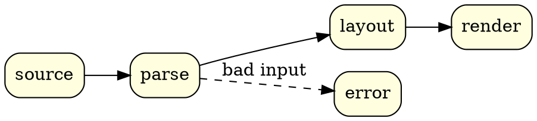

This blog renders diagrams from fenced code blocks. Until now that meant `pikchr` and
`gnuplot`. It now also renders `graphviz`, `smiles`, `smarts`, `spice` and `onnx`. Every fence
becomes inline SVG when the site is built, using the same renderers as my VS Code
previews. Visitors get finished pictures: no JavaScript and no wasm.

This page has one fence of each kind. It also checks every build: if any of these
stops rendering, the site doesn't deploy.

## Graphviz

A `graphviz` fence holds a DOT graph:

````markdown

````

```graphviz {alt="A four-stage pipeline from source to render, with parse branching to error"}
digraph {
  rankdir=LR
  node [shape=box style="rounded,filled" fillcolor=lightyellow]
  source -> parse -> layout -> render
  parse -> error [label="bad input" style=dashed]
}
```

The `layout` attribute picks the other Graphviz engines, and `caption` adds a figure
caption:

```graphviz {alt="Four nodes laid out by neato" caption="The same language, laid out by neato."}
graph {
  layout=neato
  node [style=filled fillcolor=lightblue]
  a -- b -- c -- a
  c -- d
}
```

## SMILES

A `smiles` fence holds one molecule per line. Anything after the first space is a label:

````markdown
```smiles
CC(=O)Oc1ccccc1C(=O)O aspirin
```
````

```smiles {alt="The structure of aspirin"}
CC(=O)Oc1ccccc1C(=O)O aspirin
```

Several lines are drawn side by side, in a single row:

```smiles {alt="Ethanol, benzene and caffeine" caption="Ethanol, benzene and caffeine."}
CCO ethanol
c1ccccc1 benzene
Cn1cnc2c1c(=O)n(C)c(=O)n2C caffeine
```

SMILES has no notation for a polymer chain, so PubChem records polymers as the monomers
they're made from, written as one mixture with `.` between the parts. Nafion, a
perfluorinated sulfonic acid membrane, is tetrafluoroethylene plus a sulfonic acid vinyl
ether ([CID 61889](https://pubchem.ncbi.nlm.nih.gov/compound/61889)):

```smiles {alt="Nafion's monomers: a perfluorinated sulfonic acid vinyl ether and tetrafluoroethylene" caption="Nafion, as PubChem records its monomers. The ? marks a stereocentre the record leaves unspecified."}
C(=C(F)F)(OC(C(C(F)(F)F)(OC(C(F)(F)S(=O)(=O)O)(F)F)F)(F)F)F.C(=C(F)F)(F)F Nafion
```

Surlyn, an ethylene–methacrylic acid ionomer, is shown as its sodium salt
([CID 23688925](https://pubchem.ncbi.nlm.nih.gov/compound/23688925)):

```smiles {alt="Surlyn's monomers: sodium methacrylate and ethylene" caption="Surlyn (sodium), as PubChem records its monomers."}
CC(=C)C(=O)[O-].C=C.[Na+] Surlyn
```

## SMARTS

A `smarts` fence takes the same layout, but each line is a substructure pattern instead
of a molecule:

```smarts {alt="Three SMARTS patterns" caption="A carboxylic acid, a primary amine, and a six-membered carbon ring with any bonds."}
[CX3](=O)[OX2H1] carboxylic acid
[NX3;H2][CX4] primary amine
[#6]1~[#6]~[#6]~[#6]~[#6]~[#6]~1 any C6 ring
```

## SPICE

A `spice` fence holds a netlist, and the schematic is drawn from it. Netlists are read
as ngspice unless the fence names a `dialect`. Included files resolve relative to the
post, so this emitter follower takes its transistor model from a file next to this page:

````markdown
```spice
* RC low-pass driving an emitter follower
.include models/transistors.lib
V1 in 0 AC 1
R1 in mid 10k
C1 mid 0 100n
Q1 vcc mid out QN
R2 out 0 1k
VCC vcc 0 5
```
````

```spice {alt="An RC low-pass filter driving an NPN emitter follower"}
* RC low-pass driving an emitter follower
.include models/transistors.lib
V1 in 0 AC 1
R1 in mid 10k
C1 mid 0 100n
Q1 vcc mid out QN
R2 out 0 1k
VCC vcc 0 5
```

The other dialects are `ltspice`, `pspice`, `hspice`, `xyce` and `spectre`. Here is a
CMOS inverter in Spectre syntax:

````markdown
```spice {dialect="spectre"}
global 0 vdd
V1 (vdd 0) vsource dc=1.8
...
```
````

```spice {dialect="spectre" alt="A CMOS inverter driving a capacitor" caption="A CMOS inverter, written for Spectre."}
global 0 vdd
V1 (vdd 0) vsource dc=1.8
Vin (in 0) vsource type=pulse val0=0 val1=1.8
M1 (out in vdd vdd) pch w=2u l=180n
M2 (out in 0 0) nch w=1u l=180n
C1 (out 0) capacitor c=10f
model nch bsim4 type=n
model pch bsim4 type=p
```

## ONNX

An `onnx` fence holds a model written as text, and the graph is drawn in the style of
[Netron](https://netron.app). Nothing runs: only the structure is read. This small CNN
is written in the [ONNX text syntax](https://onnx.ai/onnx/repo-docs/Syntax.html):

````markdown
```onnx
<ir_version: 8, opset_import: ["" : 17]>
cnn (float[N, 3, 32, 32] x, float[8, 3, 3, 3] w = {}, float[8] b = {}) => (float[N, 10] y) {
  c = Conv <kernel_shape = [3, 3], pads = [1, 1, 1, 1]> (x, w, b)
  ...
}
```
````

```onnx {alt="A small CNN: Conv, BatchNormalization, Relu, MaxPool, GlobalAveragePool, Flatten and Gemm, top to bottom"}
<ir_version: 8, opset_import: ["" : 17]>
cnn (float[N, 3, 32, 32] x, float[8, 3, 3, 3] w = {}, float[8] b = {}) => (float[N, 10] y) {
  c = Conv <kernel_shape = [3, 3], pads = [1, 1, 1, 1]> (x, w, b)
  bn = BatchNormalization <epsilon = 0.00001> (c, scale, bias, mean, var)
  r = Relu (bn)
  p = MaxPool <kernel_shape = [2, 2], strides = [2, 2]> (r)
  g = GlobalAveragePool (p)
  f = Flatten (g)
  y = Gemm <transB = 1> (f, fc_w, fc_b)
}
```

The graph flows down unless the fence sets `direction="right"`. The protobuf text form,
what `onnx.save(…, format="textproto")` writes, is read too:

```onnx {direction="right" alt="A two-layer perceptron, MatMul, Relu and MatMul, left to right" caption="A two-layer perceptron in the protobuf text form, laid out to the right."}
ir_version: 7
producer_name: "hand"
graph {
  name: "mlp"
  node { input: "x" input: "w1" output: "h" op_type: "MatMul" }
  node { input: "h" output: "a" op_type: "Relu" }
  node { input: "a" input: "w2" output: "y" op_type: "MatMul" name: "head" }
  input { name: "x" type { tensor_type { elem_type: 1 shape { dim { dim_param: "N" } dim { dim_value: 784 } } } } }
  output { name: "y" type { tensor_type { elem_type: 1 shape { dim { dim_param: "N" } dim { dim_value: 10 } } } } }
}
```

## Pikchr and gnuplot

These two were already supported, and they render through the same pipeline:

```pikchr {alt="Seven fence languages feeding one build step that produces SVG"}
down
box "pikchr · gnuplot · graphviz" "smiles · smarts · spice · onnx" fit
arrow 0.3
box "npm run diagrams" fit
arrow 0.3
box "inline SVG" fit
```

```gnuplot {alt="A damped sine wave"}
set grid
set samples 400
plot [0:20] exp(-x/6)*sin(2*x) title "e^{-x/6} sin 2x" lw 2
```
