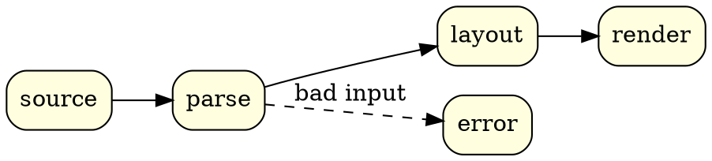

This blog renders diagrams from fenced code blocks. Until now that meant `pikchr` and
`gnuplot`. It now also renders `graphviz`, `smiles`, `smarts` and `spice`. Every fence
becomes inline SVG when the site is built, using the same renderers as my VS Code
previews. Visitors get finished pictures: no JavaScript and no wasm.

This page has one fence of each kind. It also checks every build: if any of these
stops rendering, the site doesn't deploy.

## Graphviz

A `graphviz` fence holds a DOT graph:

````markdown

````

```graphviz {alt="A four-stage pipeline from source to render, with parse branching to error"}
digraph {
  rankdir=LR
  node [shape=box style="rounded,filled" fillcolor=lightyellow]
  source -> parse -> layout -> render
  parse -> error [label="bad input" style=dashed]
}
```

The `layout` attribute picks the other Graphviz engines, and `caption` adds a figure
caption:

```graphviz {alt="Four nodes laid out by neato" caption="The same language, laid out by neato."}
graph {
  layout=neato
  node [style=filled fillcolor=lightblue]
  a -- b -- c -- a
  c -- d
}
```

## SMILES

A `smiles` fence holds one molecule per line. Anything after the first space is a label:

````markdown
```smiles
CC(=O)Oc1ccccc1C(=O)O aspirin
```
````

```smiles {alt="The structure of aspirin"}
CC(=O)Oc1ccccc1C(=O)O aspirin
```

Several lines are drawn side by side, in a single row:

```smiles {alt="Ethanol, benzene and caffeine" caption="Ethanol, benzene and caffeine."}
CCO ethanol
c1ccccc1 benzene
Cn1cnc2c1c(=O)n(C)c(=O)n2C caffeine
```

## SMARTS

A `smarts` fence takes the same layout, but each line is a substructure pattern instead
of a molecule:

```smarts {alt="Three SMARTS patterns" caption="A carboxylic acid, a C or N with a hydrogen, and an amine that is not an amide."}
[CX3](=O)[OX2H1] carboxylic acid
[C,N;!H0]~* C or N with a hydrogen
[NX3;H2,H1;!$(NC=O)] amine, not amide
```

## SPICE

A `spice` fence holds a netlist, and the schematic is drawn from it. Netlists are read
as ngspice unless the fence names a `dialect`. Included files resolve relative to the
post, so this emitter follower takes its transistor model from a file next to this page:

````markdown
```spice
* RC low-pass driving an emitter follower
.include models/transistors.lib
V1 in 0 AC 1
R1 in mid 10k
C1 mid 0 100n
Q1 vcc mid out QN
R2 out 0 1k
VCC vcc 0 5
```
````

```spice {alt="An RC low-pass filter driving an NPN emitter follower"}
* RC low-pass driving an emitter follower
.include models/transistors.lib
V1 in 0 AC 1
R1 in mid 10k
C1 mid 0 100n
Q1 vcc mid out QN
R2 out 0 1k
VCC vcc 0 5
```

The other dialects are `ltspice`, `pspice`, `hspice`, `xyce` and `spectre`. Here is a
CMOS inverter in Spectre syntax:

````markdown
```spice {dialect="spectre"}
global 0 vdd
V1 (vdd 0) vsource dc=1.8
...
```
````

```spice {dialect="spectre" alt="A CMOS inverter driving a capacitor" caption="A CMOS inverter, written for Spectre."}
global 0 vdd
V1 (vdd 0) vsource dc=1.8
Vin (in 0) vsource type=pulse val0=0 val1=1.8
M1 (out in vdd vdd) pch w=2u l=180n
M2 (out in 0 0) nch w=1u l=180n
C1 (out 0) capacitor c=10f
model nch bsim4 type=n
model pch bsim4 type=p
```

## Pikchr and gnuplot

These two were already supported, and they render through the same pipeline:

```pikchr {alt="Six fence languages feeding one build step that produces SVG"}
down
box "pikchr · gnuplot · graphviz" "smiles · smarts · spice" fit
arrow 0.3
box "npm run diagrams" fit
arrow 0.3
box "inline SVG" fit
```

```gnuplot {alt="A damped sine wave"}
set grid
set samples 400
plot [0:20] exp(-x/6)*sin(2*x) title "e^{-x/6} sin 2x" lw 2
```
